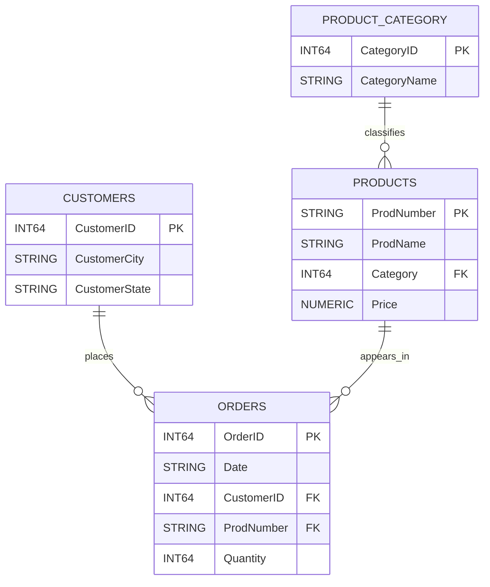

# Technology Retail Sales Performance | BI Analyst Case Study

**Bank Muamalat × Rakamin Academy — Business Intelligence Virtual Internship Experience (VIX)**  
**Case study:** PT Sejahtera Bersama · **Industry:** Technology retail / sales analytics  
**Project type:** Business Intelligence · Sales Performance · Data Modeling  
**Core tools used:** Google BigQuery (Standard SQL), Looker Studio  
**Project status:** Internship case study completed; portfolio restructured for transparency and reproducibility  
**Dashboard:** [Dashboard status and setup instructions](dashboard/README.md) — *no verified public Looker Studio URL available*  
**Repository:** https://github.com/syahhrul/bank-muamalat-bi-case-study

> **Scope clarification:** The internship program was conducted with Bank Muamalat × Rakamin Academy, but the analyzed data covers PT Sejahtera Bersama's **retail products**, **not Bank Muamalat customer accounts or banking transactions**. Monetary units are **unspecified in the source files**, so results below are labeled *sales value* without an assumed currency.


## 1. Executive Summary

This project consolidates four source tables into a transaction-level sales model to help a retailer understand performance over time, category contribution, and geographic differences. Across **3,339 orders** between **1 January 2020 and 31 December 2021**, recorded sales value totals **1,754,750.57**, while 2021 sales decreased **7.85%** versus 2020. **Robots contribute 42.37% of sales value** despite representing **9.04% of units**, whereas **eBooks contribute 26.80% of units** but only **3.36% of sales value**. Recommended next steps are to investigate the decline by segment, test cross-selling, and validate decisions using additional inventory and profitability data.

### KPI snapshot

| KPI | Result | Definition |
|---|---:|---|
| Total sales value | **1,754,750.57** | Sum of `Quantity × Price` (currency unverified) |
| Orders | **3,339** | Count of distinct `OrderID` |
| Units sold | **11,654** | Sum of `Quantity` |
| Purchasing customers | **1,671** | Distinct customer IDs with ≥ 1 order |
| Average order value | **525.53** | Sales value / orders |
| 2021 YoY sales change | **−7.85%** | (2021 sales / 2020 sales − 1) × 100 |
| Customers with 2+ orders | **987 (59.07%)** | Share of observed purchasing customers, **not** retention rate |

**Important:** These are descriptive statistics for the *historical case-study dataset*, not actual contemporary performance or proven business outcomes.

## 2. Business Problem

### Background

The case-study retailer keeps purchases, customers, products, and product categories in separate tables. Without a common transaction model and clearly defined KPIs, it is harder to compare product mix, locations, and sales trends consistently.

### Business questions

1. Which categories generate the most sales value versus the most unit volume?
2. How did sales change between 2020 and 2021, and where should analysts investigate the decline?
3. Which customer and location segments could be explored for targeted marketing experiments?

### Objectives

- Model and validate the four relational tables and their primary/foreign keys.
- Produce a single order-grain reporting table and consistent business metrics.
- Build a BI reporting workflow that converts patterns into testable recommendations.

**Intended stakeholders (hypothetical for this exercise):** Sales Manager, Product/Category Manager, and Marketing Analyst. These are proposed consumers of the analysis, not verified roles within the case-study organization.

## 3. Dataset Overview

| Source table | Role | Primary key | Rows |
|---|---|---|---:|
| `Customers.csv` | Customer/location dimension (publicly minimized) | `CustomerID` | 2,123 |
| `Orders.csv` | Transaction fact | `OrderID` | 3,339 |
| `Products.csv` | Product dimension | `ProdNumber` | 70 |
| `ProductCategory.csv` | Product category dimension | `CategoryID` | 7 |
| `master_table.csv` | Reproducible joined reporting table | `order_id` | 3,339 |

**Period:** 2020-01-01 to 2021-12-31. **Data provenance:** educational CSVs supplied for the virtual-internship case study. Whether the original dataset is synthetic and whether external redistribution is authorized have **not been independently verified**. The portfolio workflow strips personal-name, email, phone, street-address, and ZIP fields from the public customer data. Do not upload the original unfiltered customer file or master table. See [privacy and data limitations](docs/data_dictionary.md).

### Relationship diagram



**Data grain:** one row per `OrderID`; each order record references one customer and one product. A `LEFT JOIN` starts from Orders to avoid silently losing transactions. More detail: [data dictionary](docs/data_dictionary.md).

## 4. Methodology

**Source CSVs → public-field minimization → BigQuery staging tables → SQL quality assertions → relational joins → KPI analysis → Looker Studio**

1. **Data understanding:** inspect source schemas, keys, coverage and relationships.
2. **Data cleaning and privacy:** retain `CustomerID`, city and state in the public customer table; parse day-first dates (`DD/MM/YYYY`) and calculate order totals using decimal arithmetic.
3. **Data validation:** check non-null/unique primary keys, matched foreign keys, valid dates, positive quantities and nonnegative prices. BigQuery `NOT ENFORCED` constraints are not a substitute for these checks.
4. **Data integration:** `LEFT JOIN` Orders → Customers → Products → ProductCategory to build an analysis-ready table without direct personal identifiers.
5. **EDA and business analysis:** compare annual and monthly sales, category sales versus units, city differences and the observed multi-order customer share.
6. **BI dashboard:** original project used Looker Studio for sales KPIs, category and city comparisons, rankings and date/category/city filters. A publicly accessible copy or verified screenshot is **not provided** in this repository; [dashboard notes](dashboard/README.md) document how to recreate it.

**Actual SQL files:** [schema and loading](sql/01_setup_tables.sql) · [quality checks](sql/02_data_quality.sql) · [master-table build](sql/03_build_master_table.sql) · [analysis queries](sql/04_sales_analysis.sql).

## 5. Technical Skills Demonstrated

| Area | Demonstrated technique |
|---|---|
| **SQL / BigQuery** | `CREATE TABLE`, `LEFT JOIN`, aggregations, `SAFE.PARSE_DATE`, CTEs, window-based YoY comparison, `ASSERT` checks (new portfolio improvements) |
| **Data modeling** | Fact and dimension tables, keys, joins, transaction-level grain |
| **BI / reporting** | KPI definition, category/time/location comparisons, Looker Studio as the original dashboard tool |
| **Data quality** | Duplicate-key, referential-integrity, null/date and calculation checks |
| **Analytical storytelling** | Evidence → interpretation → proposed action → success metric |
| **Portfolio engineering** | Standard-library Python scripts for publishing minimized CSVs and reproducible validation; **added during portfolio revision, not part of the original internship deliverable** |

## 6. Key Findings

### Finding 1 — Sales value declined in 2021

- **Evidence:** 2020 **913,210.09** → 2021 **841,540.48**, or **−7.85% YoY**.
- **Meaning:** performance weakened in the comparison year. The two annual totals alone **do not establish why**; segment/month drill-down is needed.
- **Actionable question:** was the decrease driven by fewer orders, lower order value, changes in product mix, or specific segments?

### Finding 2 — Premium categories drive disproportionate sales value


- **Evidence:** **Robots 743,505.00 / 42.37% sales share** and **1,053 / 9.04% unit share**. Drones contribute an additional **27.21% of sales value**.
- **Meaning:** relatively low-volume categories account for most reported sales value. This is *not evidence of higher profit margins* because product costs are unavailable.
- **Actionable question:** which premium products are at risk from concentration or inventory constraints?

### Finding 3 — eBooks dominate quantity, not value

- **Evidence:** **3,123 eBooks / 26.80% of units**, but only **58,968.41 / 3.36% of sales value**.
- **Meaning:** a high-volume, low-price category may be suitable for a tested add-on or bundle offer; success is not guaranteed.
- **Actionable question:** can an eBook add-on increase average order value without harming conversion or margin?

### Supporting finding — Multi-order customer behavior

Among **1,671 purchasing customers**, **987** placed at least two orders during the dataset period (**59.07%**). This is a descriptive **multi-order customer share**; it is **not** a customer retention rate, which requires a defined cohort and observation window.

[Detailed evidence and interpretation](reports/insights.md) · [KPI formulas](docs/kpi_definitions.md)

## 7. Business Recommendations

| Insight | Proposed action (not yet implemented) | How to measure success |
|---|---|---|
| Sales fell 7.85% in 2021 | Investigate monthly category and city drivers; test targeted offers on selected segments | Segment YoY growth; incremental lift versus comparison group |
| Robots account for 42.37% of value | Monitor concentration and validate availability of top products once inventory data is obtained | Premium category sales; stockout rate if available |
| eBooks have 26.80% of units but only 3.36% of value | A/B test an eBook or video add-on alongside premium products | Average order value; bundle attach rate; incremental gross profit if costs become available |
| Many customers have 2+ observed orders | Explore segmentation by frequency and order value before designing reactivation offers | Reorder rate using defined cohorts; repeat-order revenue |

**Decision quality:** recommendations are hypotheses supported by descriptive evidence, **not** completed interventions or causal findings.

## 8. Conclusion

The integrated dataset supports consistent measurement of 3,339 transactions and highlights a year-over-year sales decrease, a large contribution from premium products, and different patterns between sales value and unit volume. The next analytical priority is to explain the 2021 decline more precisely and evaluate experiments with additional profitability and customer-behavior data.

## 9. Limitations and Next Steps

**Limitations:** currency and redistribution rights are unverified; the data ends in 2021; prices are list prices with no discount/refund/cost data; there are no inventory or marketing-spend fields; geographic labels may be ambiguous without state; observational patterns do not prove causal effectiveness; old public Git commits may still retain original personally identifying fields.

**Planned next steps:** verify currency and permissions with the case-study provider; attach a real dashboard link/screenshot after checking access; build a monthly/category contribution-to-decline view; add margin/inventory data if authorized; test proposed actions with controlled measures. See [dashboard guidance](dashboard/README.md).

## 10. Project Structure

```text
bank-muamalat-bi-case-study/
├── data/
│   ├── raw/
│   │   ├── Customers.csv          # Public-safe: ID / city / state only
│   │   ├── Orders.csv
│   │   ├── Products.csv
│   │   └── ProductCategory.csv
│   └── processed/
│       └── master_table.csv       # No customer email/address/name
├── sql/
│   ├── 01_setup_tables.sql
│   ├── 02_data_quality.sql
│   ├── 03_build_master_table.sql
│   └── 04_sales_analysis.sql
├── scripts/
│   ├── prepare_public_data.py
│   └── verify_public_data.py
├── docs/
│   ├── data_dictionary.md
│   └── kpi_definitions.md
├── dashboard/
│   └── README.md
├── reports/
│   ├── figures/
│   │   ├── annual_sales.png
│   │   └── category_sales.png
│   ├── insights.md
│   ├── validation_results.md        # Generated by verification script
│   ├── bank_muamalat_vix_presentation.pptx  # Moved from original repo
│   └── internship_original_queries.sql      # Historical reference only
├── .github/workflows/validate-data.yml
├── .gitignore
├── UPLOAD_GUIDE.md
└── README.md
```

The generated CSVs, local validation report, and archived presentation/SQL are placed here by the [one-time migration script](scripts/prepare_public_data.py); they are **not** contained in the documentation patch alone.

## 11. How to Reproduce the Analysis

### A. Prepare the public version of the existing repository

Clone the original repository, **extract the accompanying revision ZIP over the clone**, then run:

```bash
python scripts/prepare_public_data.py
python scripts/verify_public_data.py --write-report
```

These scripts use **Python 3.10+ standard library only**; no `pip install` or `requirements.txt` is needed. The first script reads the original four CSVs, reconstructs the join with sanitized customer columns, and moves the original customer/master CSVs to the gitignored `.local_backup/` folder. Check [UPLOAD_GUIDE.md](UPLOAD_GUIDE.md) **before pushing**, especially regarding privacy and historic Git commits.

### B. Reproduce the SQL model in BigQuery

1. Create or select a Google Cloud project. In each SQL file, replace `PROJECT_ID` with the actual project ID, and keep the BigQuery dataset location consistent (`US` in the example).
2. Execute [`01_setup_tables.sql`](sql/01_setup_tables.sql).
3. Load the four CSVs from `data/raw/` into the matching pre-created tables. Set **skip header rows = 1**, comma delimiter, and **overwrite** the empty destination tables. Keep the provided schema; the source `Orders.Date` must be **STRING** because dates are `DD/MM/YYYY` (for example `13/01/2020`).
4. Execute [`02_data_quality.sql`](sql/02_data_quality.sql). Assertions must pass.
5. Execute [`03_build_master_table.sql`](sql/03_build_master_table.sql). Export its result using an explicit `ORDER BY order_date, order_id` if a sorted CSV is needed.
6. Execute [`04_sales_analysis.sql`](sql/04_sales_analysis.sql). Check the KPI snapshot above, including **3,339** master rows, **11,654** units, and **1,754,750.57** total sales value.
7. Reconnect the master table to a Looker Studio report and recreate/validate the scorecards and filters described in [`dashboard/README.md`](dashboard/README.md). There is **no verified public report link** in this project package.

**Reproducibility note:** The published `data/processed/master_table.csv` is generated with Python for convenience; the SQL process rebuilds the same business values directly from sanitized sources. No access keys, BigQuery project IDs, or actual customer contact fields are needed to reproduce the public portfolio version. The setup script **recreates** destination tables, so do not run it against production tables.

---

**Deliverable boundary:** The original internship involved SQL data modeling, analysis and a Looker Studio dashboard. The additional privacy-minimization scripts, SQL validation, explanatory charts, and reproducibility documentation are a **subsequent portfolio improvement**, not claims about additional internship responsibilities.
