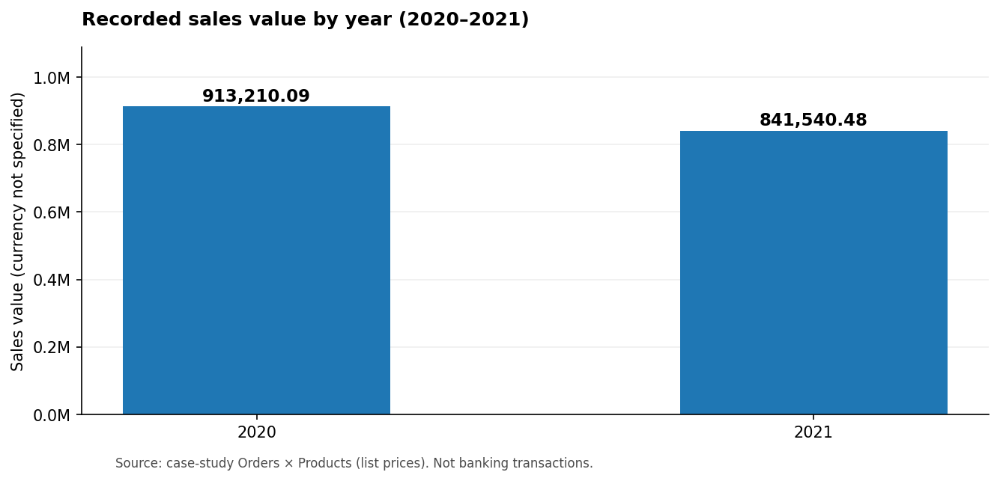
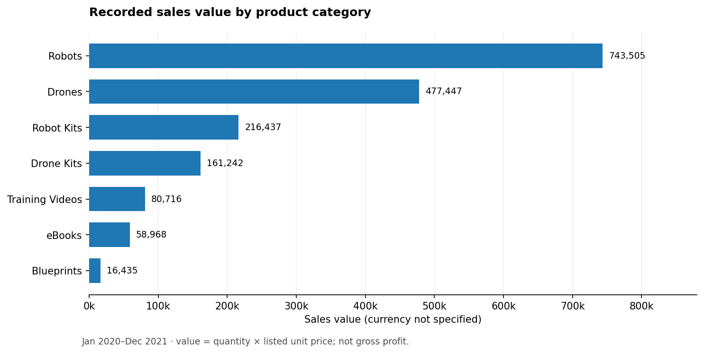

# Sales performance — analysis notes

**Case study:** PT Sejahtera Bersama technology-product retail sales. The original source does not specify the monetary unit; figures below are **numeric sales values, not confirmed IDR/USD revenue**. All findings are descriptive and limited to 2020–2021.

## Finding A — 2021 sales declined

| Year | Sales value | Orders | Units |
|---|---:|---:|---:|
| 2020 | 913,210.09 | 1,693 | 5,971 |
| 2021 | 841,540.48 | 1,646 | 5,683 |
| **Total** | **1,754,750.57** | **3,339** | **11,654** |

The year-over-year sales value change is **−7.85%**. Orders also fell from 1,693 to 1,646 and units fell from 5,971 to 5,683, but annual totals alone cannot identify an underlying cause. The suggested next drill-down is the monthly trend followed by category-level contribution to the decline ([SQL](../sql/04_sales_analysis.sql)).

## Finding B — High-value product categories

| Category | Sales value | Sales share | Units | Unit share |
|---|---:|---:|---:|---:|
| Robots | 743,505.00 | 42.37% | 1,053 | 9.04% |
| Drones | 477,447.00 | 27.21% | 1,227 | 10.53% |
| Robot Kits | 216,437.00 | 12.33% | 1,037 | 8.90% |
| Drone Kits | 161,242.50 | 9.19% | 1,515 | 13.00% |
| Training Videos | 80,716.15 | 4.60% | 2,081 | 17.86% |
| eBooks | 58,968.41 | 3.36% | 3,123 | 26.80% |
| Blueprints | 16,434.51 | 0.94% | 1,618 | 13.88% |
| **Total** | **1,754,750.57** | **100.00%** | **11,654** | **100.00%** |

**Interpretation:** Robots and Drones collectively account for ~69.58% of sales value but significantly less of unit volume. Their unit prices are higher; the dataset does not contain cost/profitability information to support margin claims. eBooks lead in quantity but make up a small proportion of sales value. Bundling and add-on sales are hypotheses to test, not verified solutions.

## Finding C — City and repeat-order context

Aggregating by the original **city-only** field, **Washington (55,381.94)** and **Houston (33,761.49)** rank among the highest cities by sales value. City names may repeat across states, so production reporting should group city and state together; the [new master table](../docs/data_dictionary.md) preserves both.

Of 2,123 records in the customer dimension, 1,671 customer IDs appear in the orders data. **987** purchasers have at least two orders (59.07% of the purchasing customer base). This does not imply 59.07% retention or prove a loyalty campaign would succeed.

## Proposed actions and experimental evaluation

1. **Diagnose the 2021 decline:** identify the monthly and category drivers; compare segment-level change over a consistent time window. KPI: YoY sales value and orders by segment.
2. **Protect high-contribution categories:** check premium product availability and product concentration once inventory and service data are available. KPI: category sales, stockout rate (if available).
3. **Test eBook/video attach offers:** conduct a controlled trial rather than immediately broadening a campaign. KPI: add-on attach rate, average order value and incremental gross profit (if costs can be obtained).
4. **Validate customer segmentation:** analyze order-frequency and recency with a clear cohort definition and additional dates. KPI: cohort repeat-order rate, not the unqualified 59.07% figure.

**Reproduction:** [`sql/04_sales_analysis.sql`](../sql/04_sales_analysis.sql) contains the aggregations. [`scripts/verify_public_data.py`](../scripts/verify_public_data.py) verifies the dataset baseline after public migration.
